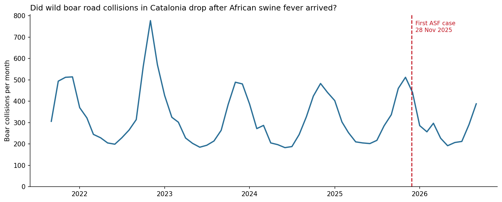
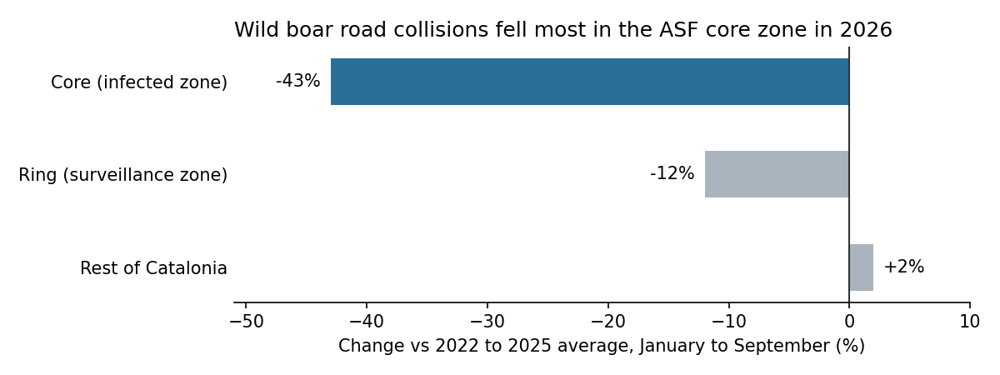
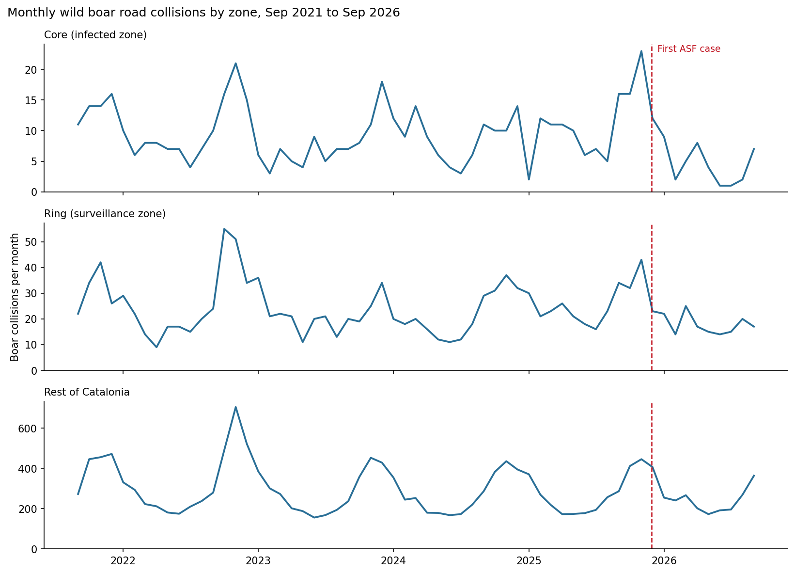

# African swine fever and wild boar road collisions in Catalonia

**Question:** after African swine fever (ASF) appeared in wild boar around Collserola (first case 28 Nov 2025) and the outbreak zone started culling and fencing, did wild boar road collisions drop in the affected area compared with the rest of Catalonia?

**Status:** finished for now (November 2026). The answer so far: collisions dropped in the core of the outbreak zone and not in the rest of Catalonia, slightly more than in normal years. A signal, not proof. To be updated when the dataset includes months after September 2026.

## Data

Wild animal road collisions attended by the Mossos d'Esquadra, published on Transparència Catalunya (dataset [`ght6-dqp5`](https://analisi.transparenciacatalunya.cat/resource/ght6-dqp5.json)). 31,003 collisions, 2021 to September 2026, of which 19,929 involve wild boar.

## First look

January to September 2026 looks like the same months in earlier years (2,357 boar collisions, against 2,290 to 2,415 in 2022 to 2025). Collisions follow a clear seasonal pattern: lower in winter and spring and higher in autumn, with the mating season, hunting season and young boar dispersing.

For Catalonia as a whole there is no visible change after the outbreak. The outbreak zone is a small part of Catalonia, so a drop there would barely move the total. The next step is to compare the zone with the rest of Catalonia.

## Finding: outbreak zone vs rest of Catalonia

- **Comparison:** January to September 2026 (the 2026 months in the data) against the same months in the normal years 2022 to 2025.
- **Result:** wild boar collisions fell by 43% in the core and 12% in the ring, and rose by 2% in the rest of Catalonia.
- **Check against normal years:** comparing each year with the one before (January to September), the core changed by −21%, +40% and +8% between 2022 and 2025, and by −51% from 2025 to 2026. The 2026 drop is slightly bigger than the largest normal change. The ring's 2026 change (−25%) is within its normal range (up to +36%), and the rest of Catalonia stayed flat (+2%, normal changes up to 3%).
- **Interpretation:** whatever lowered collisions in 2026 didn't happen across Catalonia. It happened in the core, where culling and fencing were most intense. Anything that affects all of Catalonia, such as weather or a change in how collisions are recorded, would have lowered the rest too.
- **Limits:** the margin is small. The core went from 80 collisions in 2025 to 39 in 2026, and about 9 collisions decide whether the drop is bigger than normal. The data also can't separate fewer boar (culling) from fewer people driving in the area after Collserola was closed in March 2026.

**Zone definition:** the 91 municipalities of the official infected and surveillance zone ([`zone.csv`](zone.csv), checked against the EU zone list per comarca), split into **core** (12 municipalities, 6 km infected radius) and **ring** (the other 79). Everything else is the rest of Catalonia.

## Monthly view

The core's monthly line jumps around in every year, because it has only about 8 collisions a month. But July to September 2026 stays low: 10 collisions, against 19 to 28 in the same months of 2022 to 2025. The ring is just below its normal range (52 against 54 to 73), and the rest of Catalonia is higher than usual (829 against 599 to 738).

## Data quality log

- **API row limit:** the API returns only 1,000 rows by default, so `$limit=50000` loads all 31,004 rows, and an assert stops the notebook if the limit is ever reached. In November 2026 the dataset passed the old limit of 30,000 and rows were silently dropped, mostly from the newest months.
- **"Total" row:** the year column had a "Total" summary row. It's removed, which leaves 31,003 rows.
- **Injury columns count people:** `ferits_lleus`, `ferits_greus` and `morts` count people, not animals. A blank means 0.
- **Labels:** the exact label for wild boar is `Ungulat (porc senglar)`. Some bird labels are duplicated.
- **2026 is partial:** the data stops at 30 September 2026.
- **2021 is not comparable before September:** from January to August 2021 there are only 21 to 55 boar collisions a month, then 306 in September and around 500 a month to December. January to August 2022 has 199 to 370 a month, and September matches in both years (306 vs 314), so the jump is likely a change in recording from September 2021, not fewer collisions. Monthly analysis starts in September 2021; yearly totals use 2022 to 2025 only.
- **Municipality names vary, codes don't:** El Prat de Llobregat appears with two spellings, so the zone is joined on the municipality code, not the name.
- **One wrong code:** a single Torrelles de Llobregat row carries the code of Torrelles de Foix, so it lands in the rest of Catalonia (1 row, kept and documented).
- **5 zone municipalities never appear** in the collisions data, so they have no rows to match.

## Conclusion

- **Answer so far:** collisions in the core dropped by about half in 2026, slightly more than in any normal year, while the rest of Catalonia stayed flat. That points to something local, such as the ASF response, but with so few collisions it is a signal, not proof.
- **What would answer it better:** more months, especially October to December 2026, when collisions peak. When the dataset is updated, I'll repeat the year to year check and the monthly view.
- **What I learned:** a big number isn't always an answer. With six months, a 38% drop was within normal variation; with nine months, the drop became slightly bigger than normal. Each result needs to be checked against normal variation before anyone believes it. And data grows: a row limit that loaded everything in October silently cut the data in November.

## Files

- `asf_wild_boar_analysis.ipynb`: the full analysis: loading, cleaning, data quality checks, monthly chart, outbreak zone comparison, year to year check and monthly view by zone.
- `zone.csv`: the 91 outbreak zone municipalities with zone, start date, code and source.

Nade Cvetanovska · data analyst with veterinary domain expertise · [github.com/Nade94](https://github.com/Nade94)
