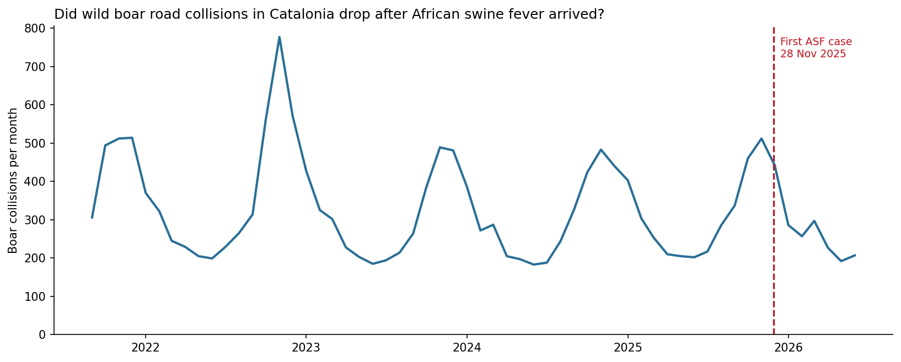
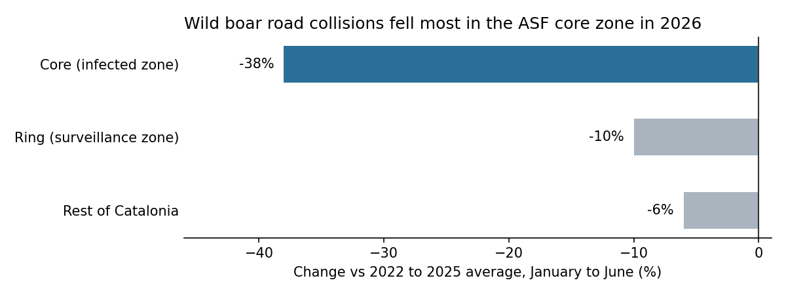

# African swine fever and wild boar road collisions in Catalonia

**Question:** after African swine fever (ASF) appeared in wild boar around Collserola (first case 28 Nov 2025) and the outbreak zone started culling and fencing, did wild boar road collisions drop in the affected area compared with the rest of Catalonia?

**Status:** work in progress. First finding below: January to June 2026 against the same months in 2022 to 2025, for the outbreak zone and the rest of Catalonia.

## Data

Wild animal road collisions attended by the Mossos d'Esquadra, published on Transparència Catalunya (dataset [`ght6-dqp5`](https://analisi.transparenciacatalunya.cat/resource/ght6-dqp5.json)). 29,485 collisions, 2021 to June 2026, of which 19,038 involve wild boar.

## First look

January to June 2026 looks like the same months in earlier years (1,466 boar collisions, against 1,531 to 1,670 in 2022 to 2025). Collisions follow a clear seasonal pattern: lower from January to June and higher in autumn, with the mating season, hunting season and young boar dispersing.

For Catalonia as a whole there is no visible change after the outbreak. The outbreak zone is a small part of Catalonia, so a drop there would barely move the total. The next step is to compare the zone with the rest of Catalonia.

## Finding: outbreak zone vs rest of Catalonia

- **Comparison:** January to June 2026 (the only 2026 months in the data) against the same months in the normal years 2022 to 2025.
- **Result:** wild boar collisions fell by 38% in the core, 10% in the ring and 6% in the rest of Catalonia.
- **Interpretation:** the drop is largest where culling and fencing were most intense, and smallest outside the zone. The rest of Catalonia also fell, so the part of the core's drop that could be linked to ASF is the difference: about 32 percentage points.
- **Limits:** the core numbers are small (29 collisions in 2026 against about 46 in a normal year), so the pattern is consistent with an effect but doesn't prove one. The data also can't separate fewer boar from fewer people driving in the area after Collserola was closed in March 2026.

**Zone definition:** the 91 municipalities of the official infected and surveillance zone ([`zone.csv`](zone.csv), checked against the EU zone list per comarca), split into **core** (12 municipalities, 6 km infected radius) and **ring** (the other 79). Everything else is the rest of Catalonia.

## Data quality log

- **API row limit:** the API returns only 1,000 rows by default, so `$limit=30000` loads all 29,486 rows.
- **"Total" row:** the year column had a "Total" summary row. It's removed, which leaves 29,485 rows.
- **Injury columns count people:** `ferits_lleus`, `ferits_greus` and `morts` count people, not animals. A blank means 0.
- **Labels:** the exact label for wild boar is `Ungulat (porc senglar)`. Some bird labels are duplicated.
- **2026 is partial:** the data stops at 30 June 2026.
- **2021 is not comparable before September:** from January to August 2021 there are only 21 to 55 boar collisions a month, then 306 in September and around 500 a month to December. January to August 2022 has 199 to 370 a month, and September matches in both years (306 vs 314), so the jump is likely a change in recording from September 2021, not fewer collisions. Monthly analysis starts in September 2021; yearly totals use 2022 to 2025 only.
- **Municipality names vary, codes don't:** El Prat de Llobregat appears with two spellings, so the zone is joined on the municipality code, not the name.
- **One wrong code:** a single Torrelles de Llobregat row carries the code of Torrelles de Foix, so it lands in the rest of Catalonia (1 row, kept and documented).
- **5 zone municipalities never appear** in the collisions data, so they have no rows to match.

## Next

1. Monthly view of the core, ring and rest from September 2021, to see when the drop started.
2. Test whether the core's drop is larger than normal year to year variation.

## Files

- `asf_wild_boar_analysis.ipynb`: the full analysis: loading, cleaning, data quality checks, monthly chart, outbreak zone comparison.
- `zone.csv`: the 91 outbreak zone municipalities with zone, start date, code and source.

Nade Cvetanovska · data analyst with veterinary domain expertise · [github.com/Nade94](https://github.com/Nade94)
